# AWS Assignment 1 - VPC & Networking

This project documents building a custom AWS VPC with public and private subnets, configuring internet routing, and testing access to EC2 instances.

## Objectives
- Create a custom VPC with public and private subnets.
- Give the public subnet direct internet routing through an Internet Gateway.
- Give the private subnet outbound internet access through a NAT Gateway.
- Restrict instance access using security groups.
- Test connectivity and remove billable resources after testing.

## Environment
- **Region:** Europe (London) — `eu-west-2`
- **Availability Zone:** `eu-west-2a`
- **VPC CIDR:** `10.0.0.0/16`
- **Public subnet:** `10.0.1.0/24`
- **Private subnet:** `10.0.2.0/24`
- **Instances:** Amazon Linux 2023, `t3.micro`
- **Provisioning:** AWS Management Console

## Architecture

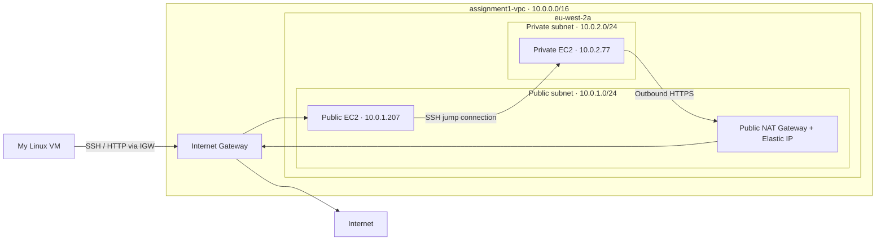

The public EC2 served a test web page and acted as a jump host for SSH
access to the private EC2. The private instance reached the internet
through the NAT Gateway without having a public IP address.

Both subnets were placed in `eu-west-2a`. This was a single-AZ learning
lab, rather than a highly available production deployment.

The diagram shows the architecture before cleanup. Arrows represent
the main connection paths; response traffic follows the return paths.

## Routing and Security

Each subnet had its own explicitly associated route table.

| Route table | Destination | Target |
| --- | --- | --- |
| Public | `10.0.0.0/16` | Local |
| Public | `0.0.0.0/0` | Internet Gateway |
| Private | `10.0.0.0/16` | Local |
| Private | `0.0.0.0/0` | NAT Gateway |

The local routes allowed communication within the VPC. The public
default route provided an internet path through the IGW, while the
private default route sent internet-bound traffic through NAT.

### Security Groups

| Security group | Inbound traffic | Allowed source |
| --- | --- | --- |
| `assignment1-public-sg` | SSH — TCP 22 | My public IPv4 address `/32` |
| `assignment1-public-sg` | HTTP — TCP 80 | My public IPv4 address `/32` |
| `assignment1-private-sg` | SSH — TCP 22 | `assignment1-public-sg` |

Both groups retained the default outbound allow rule.

Referencing the public security group allowed SSH from the private
addresses of instances using that group. It did not copy the public
group's rules into the private group.

The private instance had no public IPv4 address. I accessed it through
the public EC2 using SSH, keeping the private key on my local Linux VM.

## User Data

The public EC2 used [public-user-data.sh](public-user-data.sh) to install
Apache, create the test page, and start the service automatically.

The private EC2 did not use a user-data script.

## Testing and Results

| Test | Result |
| --- | --- |
| Open the public EC2 website over HTTP | The assignment test page loaded |
| SSH from my Linux VM to the public EC2 | Successful login as `ec2-user` |
| SSH to the private EC2 through the public jump host | Successful login |
| Private EC2 addressing | Private IPv4 only; no public IPv4 |
| Private outbound HTTPS before NAT setup | Connection timed out |
| Same request after configuring NAT and its route | Received `HTTP/2 200` |

### Before and After NAT

I ran the following command on the private EC2 before and after
configuring the NAT Gateway and private default route:

```bash
curl -I --connect-timeout 6 --max-time 10 https://aws.amazon.com
```

Before NAT setup:

```text
curl: (28) Connection timed out after 6002 milliseconds
```

After NAT setup:

```text
HTTP/2 200
```

The successful response demonstrated outbound HTTPS access from the
private instance. Its public IPv4 remained unassigned.

## Screenshots

### Network Architecture
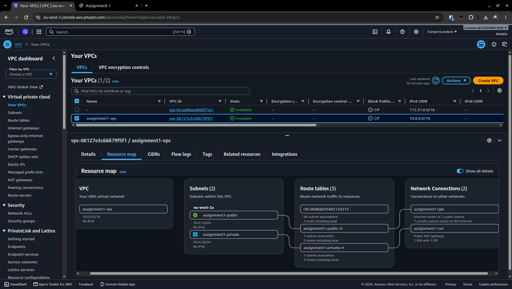

---
### Private Subnet Routing
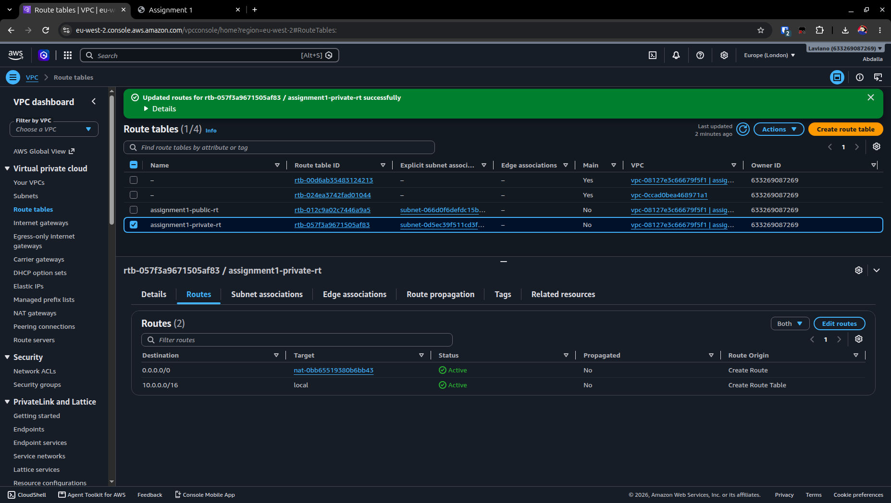

---
### NAT Gateway
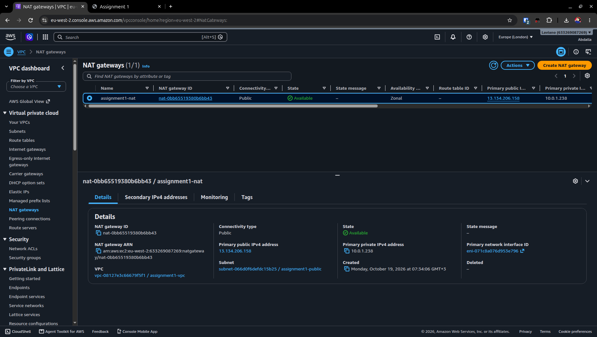

---
### Public Website
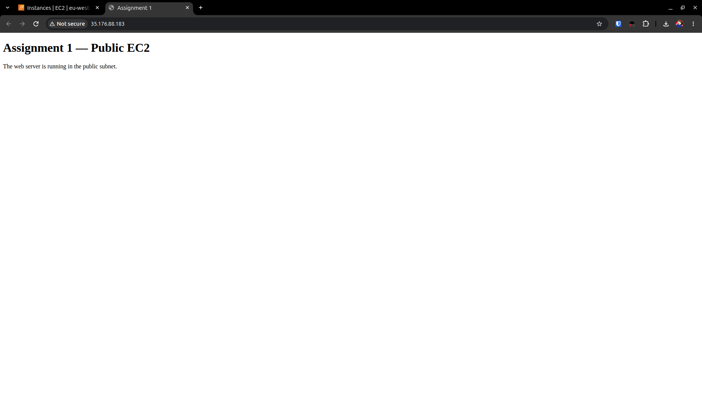

---
### Public SSH Access
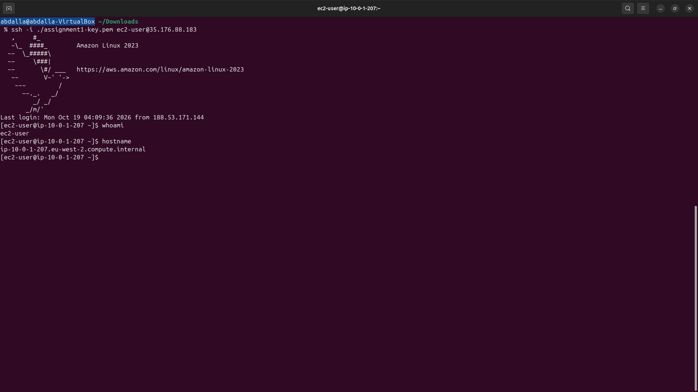

---
### Private SSH Access
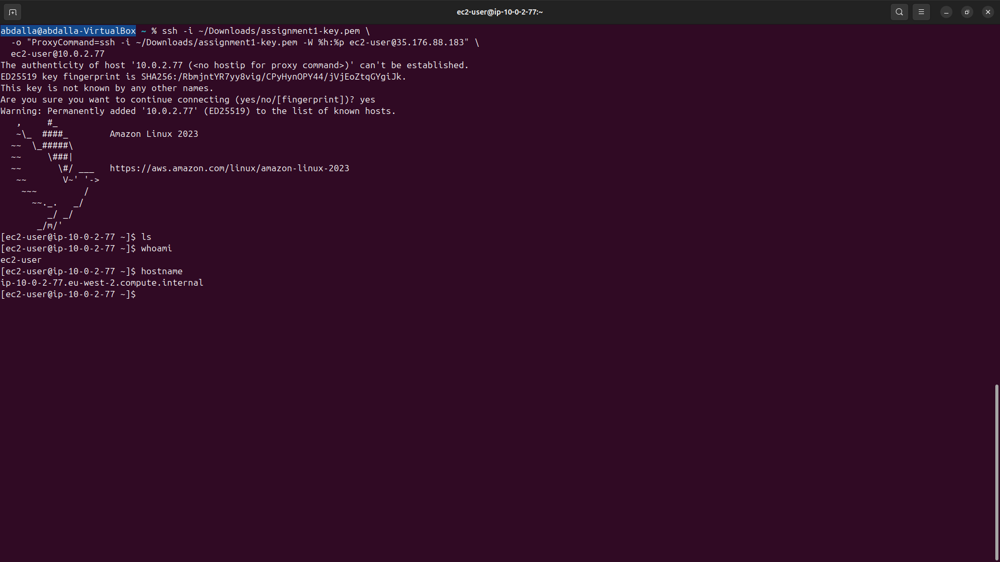

---
### Private Internet Access: Before and After NAT
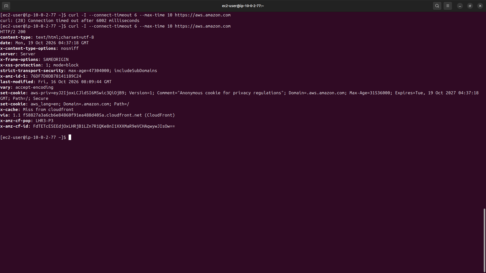

---
### Cleanup
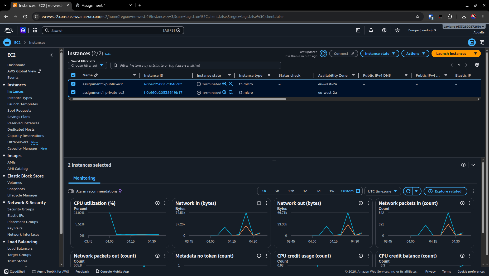

---
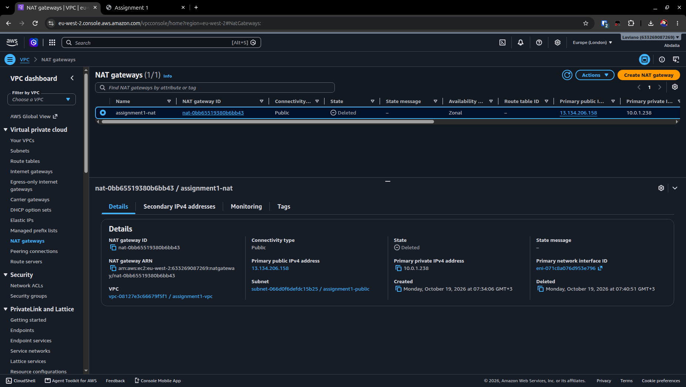

---
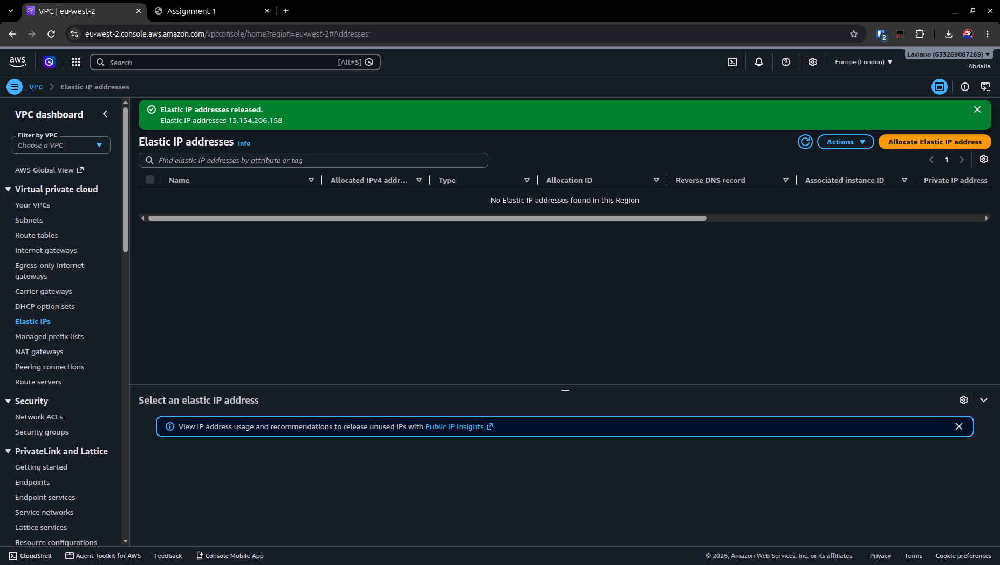

## Troubleshooting

### SSH Could Not Find My Private Key

My first SSH command used a Windows-style path inside my Linux VM:

```text
.\assignment1-key.pem
```

SSH reported that the identity file was inaccessible, followed by
`Permission denied (publickey,gssapi-keyex,gssapi-with-mic)`.

I confirmed the file existed, restricted its permissions, and used
a Linux path:

```bash
chmod 400 ~/Downloads/assignment1-key.pem
ssh -i ~/Downloads/assignment1-key.pem ec2-user@<PUBLIC_EC2_IP>
```

The login succeeded. This showed why checking the key's location and
permissions matters before changing AWS networking rules.

### Reaching the Private Instance

I used the public EC2 as an SSH jump host:

```bash
ssh -i ~/Downloads/assignment1-key.pem \
  -o "ProxyCommand=ssh -i ~/Downloads/assignment1-key.pem -W %h:%p ec2-user@<PUBLIC_EC2_IP>" \
  ec2-user@<PRIVATE_EC2_IP>
```

This command runs on my local Linux VM. The inner SSH command connects
to the public EC2 and forwards the connection to the private instance
on port 22. The outer command authenticates to the private instance.

The private key remained on my VM; I did not copy it onto either EC2.
The IP placeholders above must be replaced when reproducing the lab.

## Cost Control and Cleanup

My account's introductory free-tier period had expired, so this lab
used paid resources. I prepared the network and security groups before
launching the instances, and created the NAT Gateway only when ready
to test private outbound access.

After testing and capturing evidence, I:

- Terminated both EC2 instances.
- Deleted the NAT Gateway.
- Explicitly released its Elastic IP.
- Checked the London EBS Volumes page and confirmed no volumes remained.
- Removed the private default route pointing to the deleted NAT Gateway.

Deleting a NAT Gateway does not automatically release its Elastic IP.
Stopping EC2 also does not remove its EBS storage, so I terminated the
lab instances with root-volume deletion enabled and checked afterward.

I retained the VPC, subnets, Internet Gateway, route tables, and security
groups for later assignments. Cleanup covered the known lab resources;
it was not an audit of every resource in my AWS account.

## Key Takeaways

- A subnet's route table determines its internet path; its name does not.
- Routes provide connectivity paths, while security groups control access.
- Security-group references can permit traffic from a group of instances.
- A private instance can be reached through an SSH jump host.
- A NAT Gateway enables private IPv4 outbound connections and their replies.
- Documentation and cleanup are part of completing the lab.