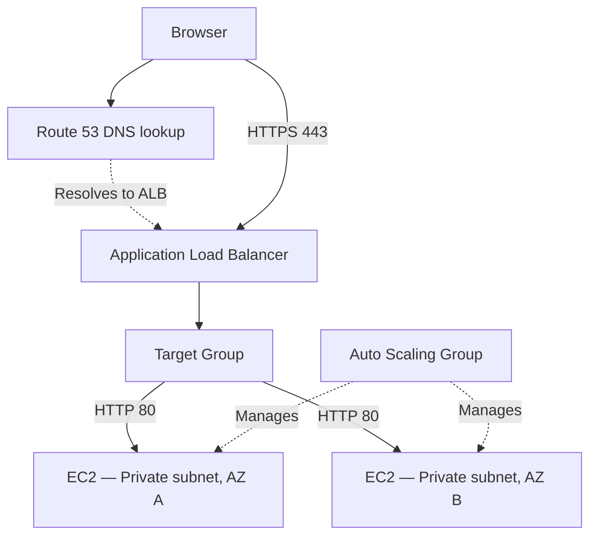
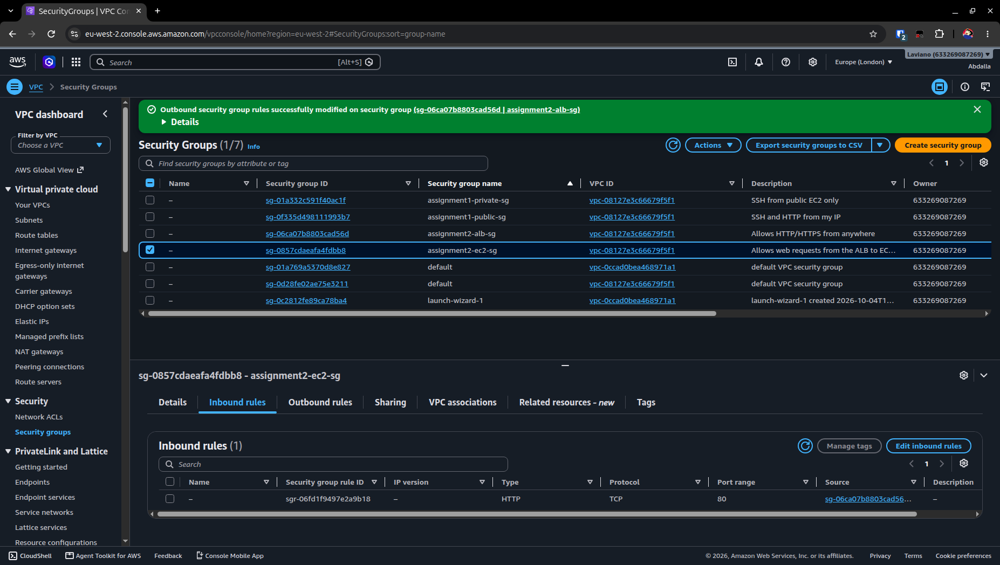
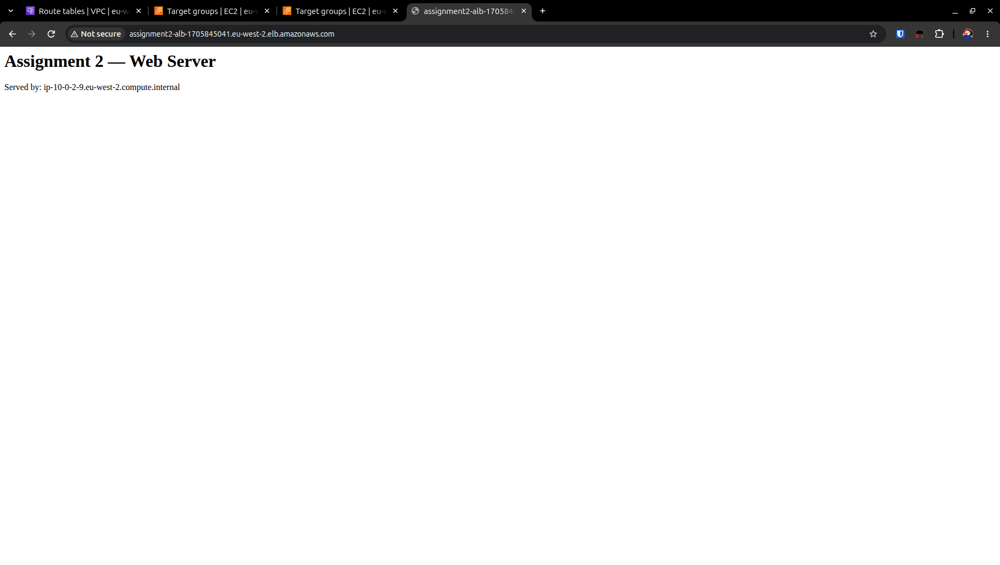
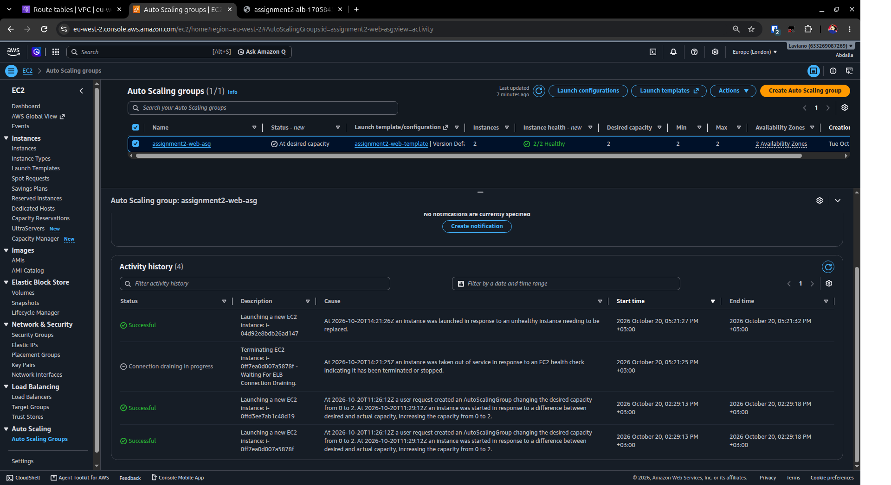
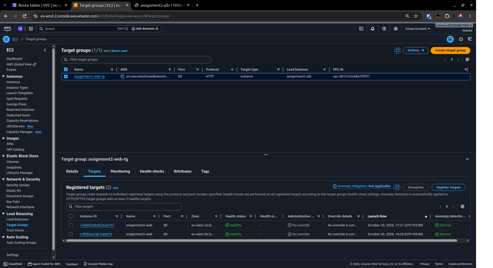
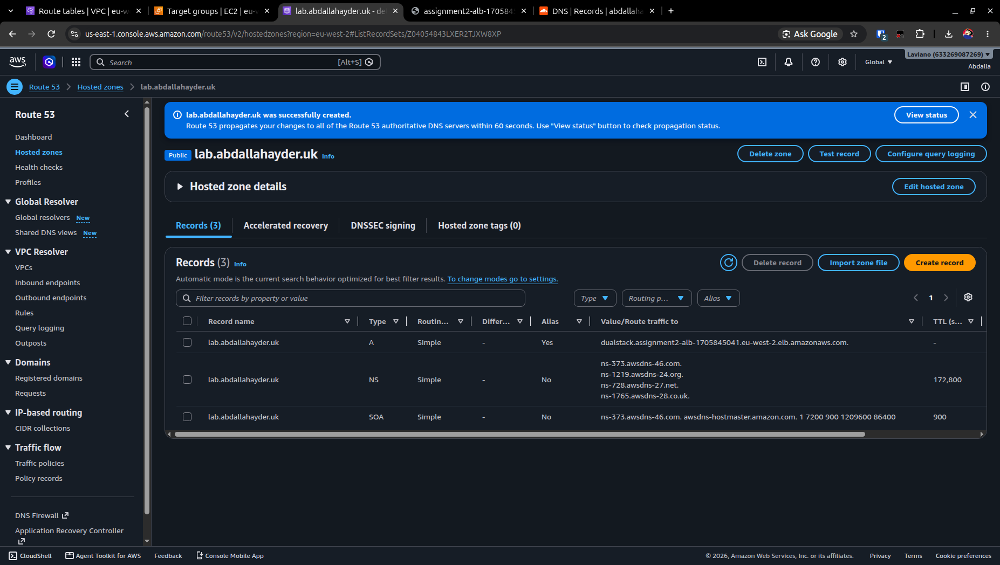
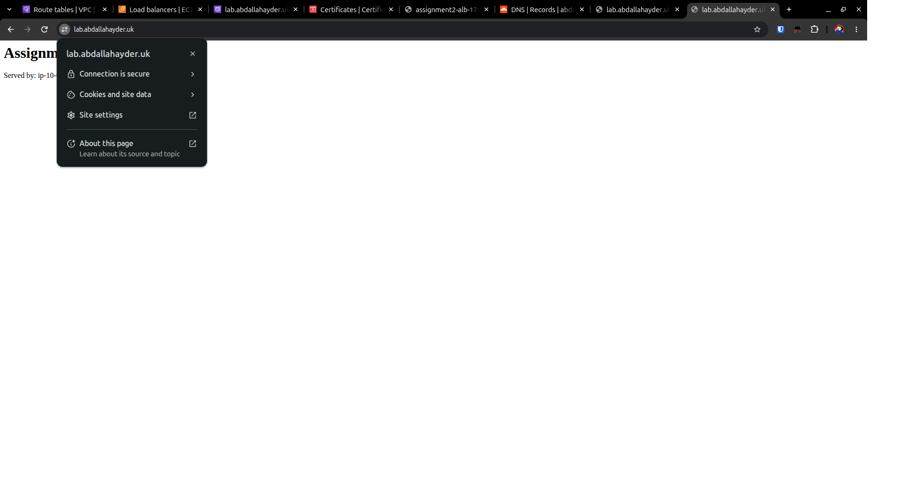
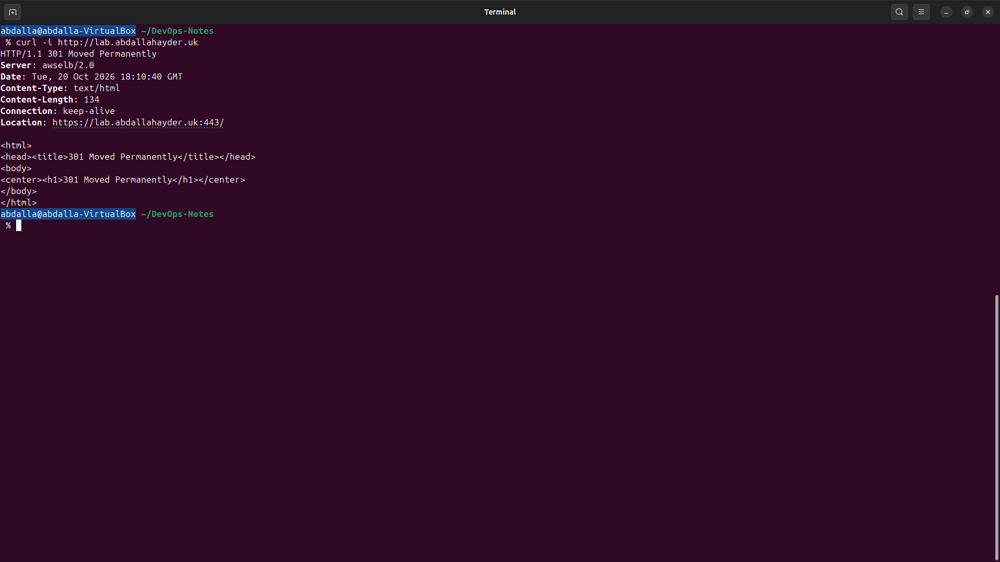
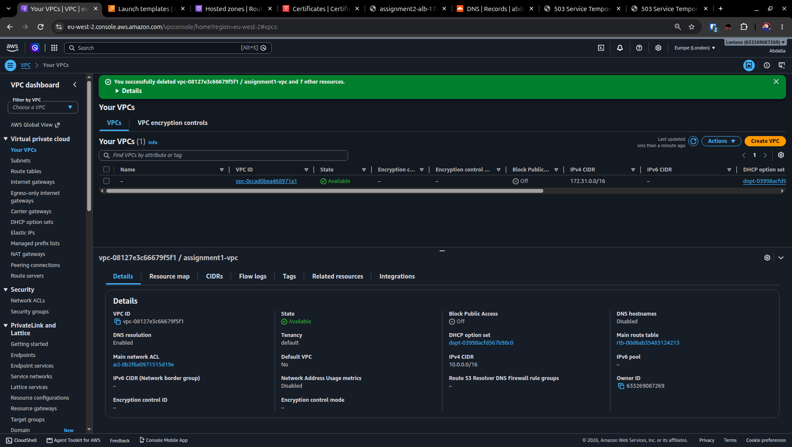

# Assignment 2 — Application Load Balancer

In this lab, I created an Auto Scaling Group with two EC2 web servers in private subnets across two Availability Zones and accessed them through an internet-facing Application Load Balancer. Configured Route 53 alias record, and HTTPS using an ACM certificate.

The lab resources were deleted after testing to avoid ongoing charges.

## Architecture



- Region: Europe (London), eu-west-2.
- One VPC with two public subnets and two private subnets across two Availability Zones.
- The ALB used the public subnets; the EC2 instances used the private subnets.
- A launch template defined the instances, and the Auto Scaling Group maintained two instances.
- A temporary NAT gateway allowed the instances to access the internet to download Apache during startup.

Traffic flow:
```text
Browser → ALB → Target group → EC2 web server
```
Route 53 pointed `lab.abdallahayder.uk` to the ALB. HTTPS ended at the ALB, which forwarded HTTP traffic to the instances on port 80.

## Security Groups

I used separate security groups for the ALB and EC2 instances:

| Security group | Inbound rules | Outbound rules |
|---|---|---|
| ALB | HTTP (80) and HTTPS (443) from anywhere | HTTP (80) to the EC2 security group |
| EC2 | HTTP (80) only from the ALB security group | All traffic |

The EC2 instances had no public IP addresses. Users reached the web servers through the ALB.

<a href="screenshots/ec2-sg-inbound.png">
  
</a>

## Web Server Setup

I added a [user-data script](user-data.sh) to the launch template to install and start Apache automatically.

Both instances used the same script. Each page displayed its instance's hostname so I could identify which server answered the request.

## Testing

### Requests reached both instances

I opened the ALB DNS name and refreshed the page. The hostname changed between the two instances, showing that both web servers were responding.

<a href="screenshots/alb-http-instance-a.png">
  
</a>

<a href="screenshots/alb-http-instance-b.png">
  
</a>

Click either screenshot to view the full-size image.

### Automatic instance replacement

I terminated one EC2 instance while the ASG's desired capacity remained at two. The ASG launched a replacement automatically.

<a href="screenshots/asg-replacement-activity.png">
  
</a>

The replacement registered in the target group and became Healthy alongside the surviving instance.

<a href="screenshots/target-group-after-replacement.png">
  
</a>

## Custom Domain and HTTPS

I created a public hosted zone for `lab.abdallahayder.uk` in Route 53. In Cloudflare, I added NS records to delegate this subdomain to Route 53.

I then created an A alias record pointing to the ALB.

<a href="screenshots/route53-alb-alias.png">
  
</a>

I requested an ACM certificate in London and validated it using a DNS record. I attached the certificate to an HTTPS listener on port 443.

<a href="screenshots/custom-domain-https.png">
  
</a>

The ALB forwarded requests to the instances over HTTP on port 80. I also changed its HTTP listener to redirect visitors to HTTPS and confirmed the 301 response using curl.

<a href="screenshots/http-to-https-redirect.png">
  
</a>

## Cleanup

After testing, I scaled the ASG down to zero and deleted the lab resources:

- ALB, ASG, launch template, and target group.
- NAT gateway and its Elastic IP.
- Route 53 hosted zone, Cloudflare delegation records, and ACM certificate.
- Lab security groups, subnets, and VPC.

I checked that no EBS volumes remained in London. I kept my domain registration and the default VPC.

<a href="screenshots/cleanup-vpc.png">
  
</a>

## What I Learned

- The ALB acts like a reception desk, forwarding requests to the web servers and returning their responses.
- The ASG creates and replaces EC2 instances using a launch template as the recipe.
- DNS lets users reach a website by name instead of memorizing IP addresses.
- I initially confused DNS lookup with HTTPS traffic. DNS finds the destination IP first,