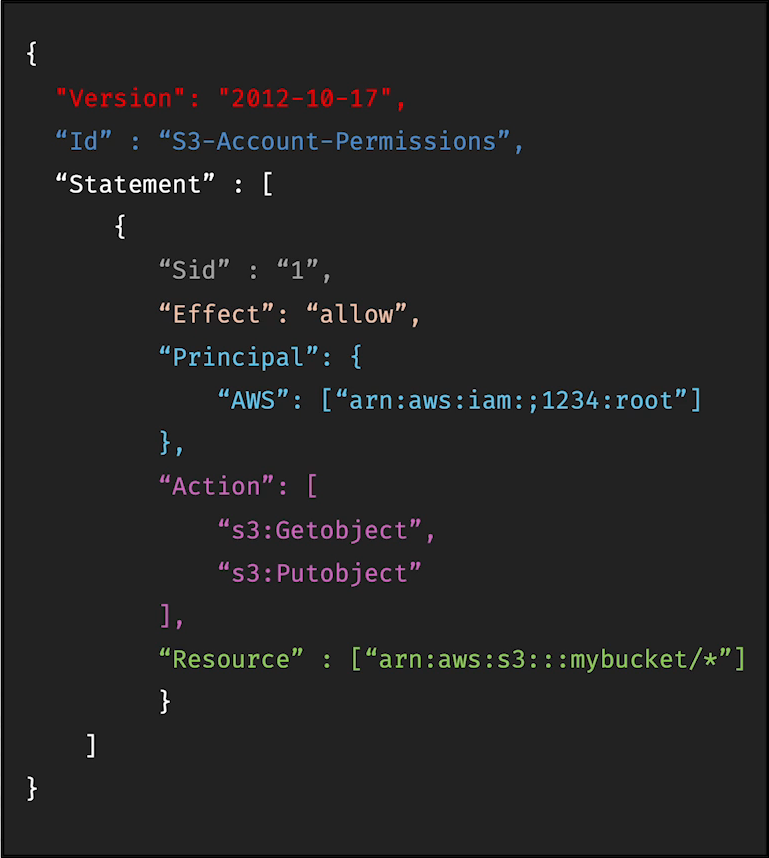

# IAM Policies Structure

IAM policies are written in **JSON** and define **who can do what, on which resource, and under what conditions**.

Main parts of a policy:

- **Version**: policy language version, always include, `2012-10-17`
- **ID** (optional): an identifier for the policy.
- **Statement**: contains the actual permission rules. Can be one or more individual statements(required)
- **Sid** (optional): label/identifier for a statement.
- **Effect**: either `Allow` or `Deny` access.
- **Principal**: who the policy applies to. Could be user/account/role; mainly used in **resource-based policies and role trust policies**.
- **Action**: list of actions this policy allows or denies (what can be done), e.g. `s3:GetObjct`.
- **Resource**: which AWS resource the action applies to. e.g. `s3 bucket` called mybucket.
- **Condition** (optional): extra rules, such as allowing access only from a specific IP.

In short, IAM policies give AWS **fine-grained control over permissions and access**.

