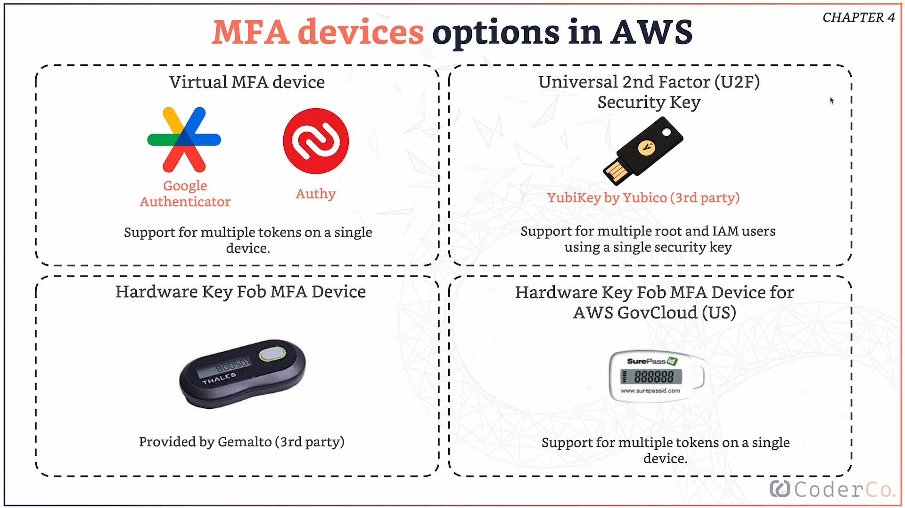

# MFA Device Options in AWS

AWS supports several MFA methods, depending on your security needs and preferences:
1. **Virtual MFA Devices**
   Apps such as **Google Authenticator, Authy, or Microsoft Authenticator** generate one-time codes. They’re free, easy to set up, and can store multiple MFA tokens.
2. **U2F Security Keys**
   Physical keys such as a **YubiKey** plug into your computer and authenticate with a tap instead of entering a code. They can be used across multiple AWS accounts or users.
3. **Hardware MFA Devices**
   Physical token devices generate a new code every few seconds. They’re useful in environments where phones or personal devices aren’t allowed.
4. **Hardware MFA for AWS GovCloud**
   Specialized hardware MFA devices used with **AWS GovCloud (US)** for government workloads with stricter security requirements.

The main takeaway is simple: **AWS gives you multiple MFA options, and using any of them is far better than relying on a password alone**.

