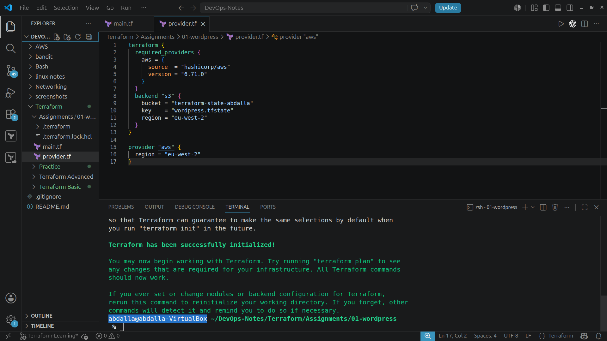
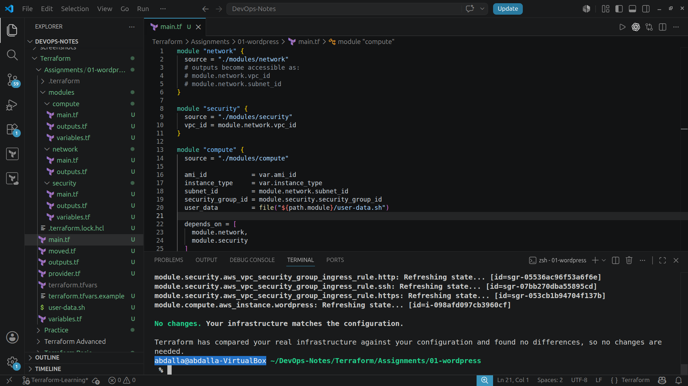
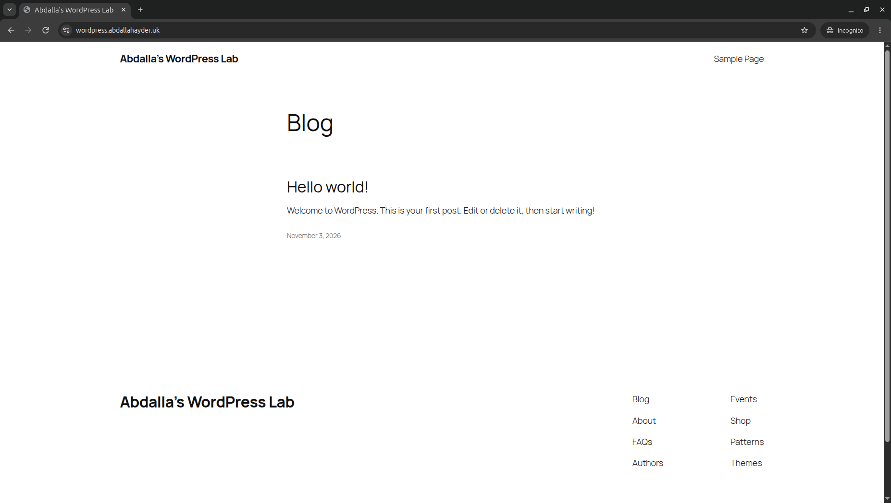
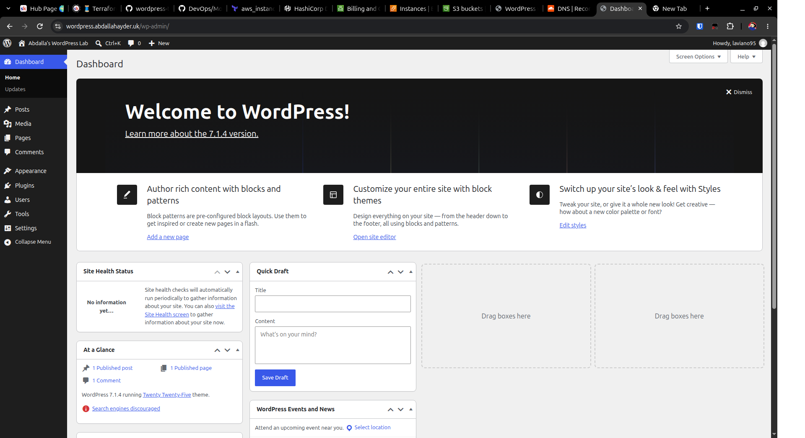
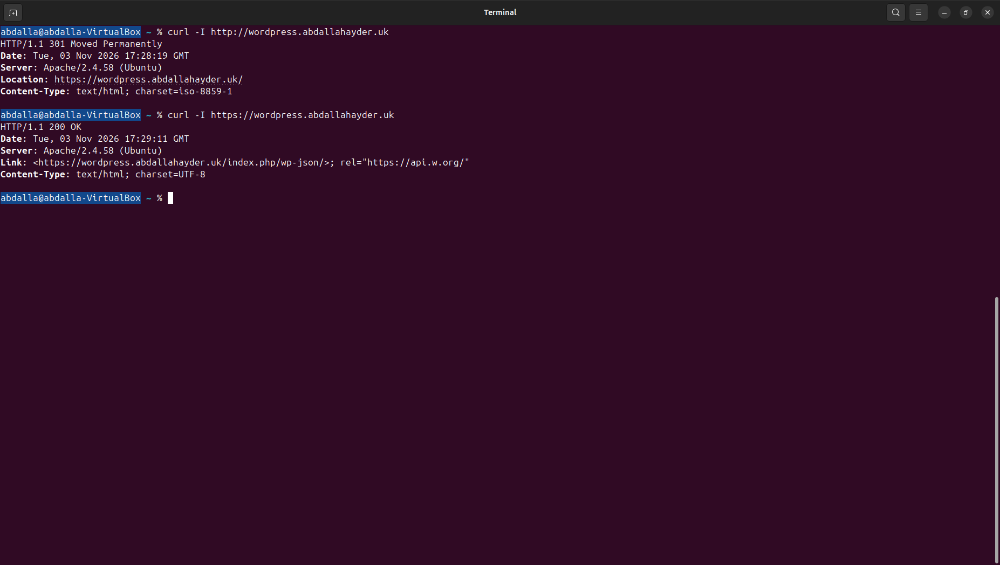

# WordPress on AWS with Terraform

This project deploys a WordPress website on an Ubuntu EC2 instance
in AWS London (`eu-west-2`).

Terraform provisions the infrastructure using three child modules:
network, security, and compute. A user-data script installs Apache,
PHP, MariaDB, and WordPress during the instance's first boot.

## Architecture

- **Network:** A custom VPC, one public subnet, an internet gateway,
  and a route table with an internet route.
- **Security:** HTTP and HTTPS are publicly accessible. SSH is
  restricted to my home public IPv4 address using a `/32` rule.
- **Compute:** One EC2 instance runs both WordPress and its MariaDB database.
- **State:** Terraform state is stored remotely in an S3 bucket.
- **DNS and HTTPS:** A Cloudflare DNS-only A record points to the
  instance. Apache serves HTTPS using a Let's Encrypt certificate
  installed through Certbot.

Infrastructure and software installation are automated. DNS configuration,
certificate setup, and the initial WordPress administrator setup were
completed manually.

This is a learning deployment with a single server, rather than a
high-availability production architecture.

## Website

Deployment URL: https://wordpress.abdallahayder.uk

The lab may be stopped or removed after assessment. The screenshots
below preserve evidence of the working deployment.

## Project Structure

```text
01-wordpress/
├── main.tf                    # Connects the three child modules
├── provider.tf                # AWS provider and S3 backend configuration
├── variables.tf               # Root inputs: AMI ID and instance type
├── outputs.tf                 # Displays instance ID, public IP, and URL
├── moved.tf                   # Records resource moves into child modules
├── .terraform.lock.hcl         # Provider version selection and checksums
├── terraform.tfvars.example    # Example input values
├── user-data.sh                # Installs and configures WordPress dependencies
├── modules/
│   ├── network/
│   │   ├── main.tf
│   │   └── outputs.tf
│   ├── security/
│   │   ├── main.tf
│   │   ├── variables.tf
│   │   └── outputs.tf
│   └── compute/
│       ├── main.tf
│       ├── variables.tf
│       └── outputs.tf
└── screenshots/
    ├── terraform-init.png
    ├── terraform-plan-no-changes.png
    ├── wordpress-homepage.png
    ├── wordpress-dashboard.png
    └── http-redirect-and-https-check.png
```

Local `terraform.tfvars`, `.terraform/` directories, and Terraform state
files are excluded from Git using the repository-level `.gitignore`.

### Module Connections

The root module passes:
- The network module's VPC ID into the security module.
- The network module's subnet ID into the compute module.
- The security module's security-group ID into the compute module.
- The AMI ID, instance type, and user-data script contents into compute.

The compute module exposes the instance details through outputs.
Root outputs then display those values in the terminal.

## Prerequisites

- Terraform installed.
- AWS credentials configured locally with permission to manage the resources.
- An existing S3 bucket for the Terraform backend.
- An existing EC2 key pair in `eu-west-2`, with its private key stored locally.
- An Ubuntu 24.04 x86_64 AMI available in `eu-west-2`.

The S3 backend bucket and EC2 key pair are prerequisites; this
configuration does not create them.

## Deploying the Infrastructure

Run the following commands from the assignment directory.

### 1. Configure the environment

Copy the example input file:

```bash
cp terraform.tfvars.example terraform.tfvars
```

Replace the placeholder AMI ID with a valid Ubuntu AMI ID for London.
Set the desired instance type.

Review the environment-specific settings:
- **`provider.tf`:** AWS region, existing S3 bucket, and state key.
  Use a separate state key for an independent deployment.
- **`modules/network/main.tf`:** VPC/subnet CIDRs and availability zone.
- **`modules/security/main.tf`:** SSH source CIDR.
  Replace it with your current public IPv4 address followed by `/32`.
- **`modules/compute/main.tf`:** Existing EC2 key-pair name.

Check your current public IPv4 address:

```bash
curl -4 https://checkip.amazonaws.com
```

### 2. Initialize and check the configuration

```bash
terraform fmt -recursive
terraform init
terraform validate
terraform plan
```

Review the plan before proceeding.

### 3. Deploy

```bash
terraform apply
```

Review the proposed actions and enter `yes` to approve them.

Terraform displays the instance ID, public IP, and HTTP URL.
The instance may be running before the user-data installation finishes.

### 4. Check the installation

Connect using the matching private key and Terraform's public IP output:

```bash
ssh -i /path/to/your-key.pem ubuntu@PUBLIC_IP
```

Inside the EC2 instance, wait for cloud-init:

```bash
sudo cloud-init status --wait
```

If installation fails, inspect its output:

```bash
sudo tail -n 100 /var/log/cloud-init-output.log
```

Once installation completes successfully, open the instance's HTTP URL.
The WordPress setup page should appear.

The database password is generated on the instance and stored in
WordPress's configuration. It is separate from the WordPress
administrator password created during browser setup.

## Manual DNS and HTTPS Setup

These steps were completed after the automated installation.

### 1. Point the domain to EC2

In Cloudflare, create an A record:

| Setting | Value |
|---|---|
| Type | A |
| Name | `wordpress` |
| IPv4 address | EC2 public IPv4 from Terraform |
| Proxy status | DNS only |
| TTL | Auto |

For this deployment, the hostname is `wordpress.abdallahayder.uk`.
Use your own domain when reproducing the project.

Check DNS from the local machine:

```bash
dig +short wordpress.abdallahayder.uk A
```

The returned address should match the instance's public IPv4.

### 2. Configure Apache's hostname

Inside EC2, edit the existing WordPress virtual host:

```bash
sudo nano /etc/apache2/sites-available/wordpress.conf
```

Add this inside the `<VirtualHost *:80>` block, keeping the existing
configuration:

```apache
ServerName wordpress.abdallahayder.uk
```

Check and reload Apache:

```bash
sudo apache2ctl configtest
sudo systemctl reload apache2
```

Only reload after the configuration test succeeds.

### 3. Enable HTTPS

Install Certbot and its Apache plugin using the
[official installation instructions](https://certbot.eff.org/).

With DNS pointing to EC2 and inbound ports 80 and 443 allowed, run
inside EC2:

```bash
sudo certbot --apache -d wordpress.abdallahayder.uk --redirect
```

Follow the prompts to register and request the certificate.
The Apache plugin installs the certificate, and `--redirect`
configures HTTP requests to redirect to HTTPS.

Certbot reported that automatic renewal was scheduled for this deployment.

### 4. Verify HTTPS and renewal

From the local machine:

```bash
curl -I http://wordpress.abdallahayder.uk
curl -I https://wordpress.abdallahayder.uk
```

Observed after WordPress setup:
- HTTP returned `301 Moved Permanently` with an HTTPS destination.
- HTTPS returned `200 OK`.

Inside EC2, test certificate renewal:

```bash
sudo certbot renew --dry-run
```

The simulated renewal completed successfully.

See the [Certbot documentation](https://eff-certbot.readthedocs.io/en/stable/using.html)
for Apache integration and renewal details.

### 5. Complete WordPress Setup

Open the HTTPS domain in a browser and complete the installation form:
- Choose a site title.
- Create a WordPress administrator username and a unique password.
- Enter an administrator email address.
- For this lab, select the option to discourage search-engine indexing.

Store the administrator password securely outside the repository.

Log in to the dashboard, then open the homepage in an incognito window
to confirm that visitors can view the site without logging in.

## Deployment Evidence

### Terraform Initialization

Terraform successfully initialized the backend and provider.



### Final Infrastructure Check

After moving the resources into modules, Terraform reported:
“No changes. Your infrastructure matches the configuration.”



### Public WordPress Homepage

The website was accessible through the custom domain without logging in.



### WordPress Dashboard

Administrator login and access to the WordPress dashboard were verified.



### HTTP Redirect and HTTPS Response

HTTP returned a redirect to HTTPS, and the HTTPS endpoint returned `200 OK`.



## Troubleshooting and Lessons Learned

### SSH Access After My Home IP Changed

When I returned to the lab, SSH access failed. My home public IPv4
address had changed, while the security-group rule still allowed
the previous address.

I checked my current address:

    curl -4 https://checkip.amazonaws.com

I updated the SSH rule's `/32` CIDR, reviewed the Terraform plan,
and applied the change. SSH access then worked.

Lesson: a home public IP can change. A restricted SSH rule needs
updating when its allowed source address changes.

### Refactoring Existing Resources into Modules

I initially built the infrastructure in the root module, then
separated it into network, security, and compute child modules.

I used `moved` blocks to map the existing resource addresses to
their new module addresses. Each migration plan showed zero
resources to add, change, or destroy.

Lesson: moving Terraform code into a module changes resource
addresses. Recording those moves preserves the relationship
between the configuration and existing infrastructure.

### Passing Values Between Modules

Child modules do not automatically share variables or access
their sibling modules.

I exposed resource IDs through outputs and passed them through
the root module into child-module inputs. For example:

    network VPC ID output → root module → security VPC ID input

Lesson: outputs expose values, inputs receive values, and the
root module connects the child modules.

### Editor Diagnostics After Adding Module Inputs

VS Code continued showing unexpected-argument errors after
I added the compute module's input declarations.

After saving the files, running `terraform init` and
`terraform validate`, and reloading the editor window,
the diagnostics cleared.

Lesson: verify editor warnings against Terraform's CLI output.

### Checking Certificate Renewal

I tested Certbot renewal using:

    sudo certbot renew --dry-run

The simulated renewal succeeded. This verified the renewal
process at the time of testing; it did not guarantee future
renewals or verify that the scheduled task would run.

## Current Limitations

- One EC2 instance hosts both the application and database,
  creating a single point of failure.
- No database backup or restore process has been configured.
- DNS, HTTPS setup, and WordPress administrator creation are manual.
- The automatically assigned public IPv4 can change after a stop/start.
- SSH access depends on a manually maintained source IP.
- Some module settings remain hardcoded for this lab.
- Terraform's website URL output uses HTTP and the instance IP;
  the custom HTTPS domain was configured separately.

## Cleanup

When the lab is no longer needed, run from the root assignment directory:

```bash
terraform plan -destroy
```

Review the proposed deletions. To proceed:

```bash
terraform destroy
```

Enter `yes` only after reviewing the destruction plan.

With this deployment's current settings, destroying the instance also
deletes its root EBS volume. This removes the local WordPress files,
MariaDB database, and TLS certificates. Back up anything needed first.

The following were created outside this Terraform configuration
and are not removed by `terraform destroy`:
- The S3 backend bucket and its stored state objects.
- The existing EC2 key pair.
- The Cloudflare DNS record.

After destroying EC2, remove the Cloudflare A record pointing to its
released public IP, unless it has been updated for another deployment.

Check the AWS console and billing dashboard for remaining resources
and charges. Billing information can take time to update.

## Possible Future Improvements

These improvements have not been implemented:

- Make hardcoded module settings configurable through inputs.
- Automate DNS and HTTPS configuration.
- Configure database and content backups, and test restoration.
- Use Systems Manager Session Manager to reduce reliance on public SSH.
- Separate the database into Amazon RDS.
- Explore a load balancer and multiple application instances,
  with shared content storage and session requirements considered.
- Add monitoring and cost alerts.

These changes introduce additional complexity and potentially
additional cost. The current project focuses on the assignment's
single-instance WordPress deployment.