# EC2 Deployment with Cloud-Init

This project uses Terraform to deploy an Ubuntu EC2 instance in
AWS London (`eu-west-2`). Cloud-init installs NGINX, creates a custom
homepage, and enables the web server automatically during first boot.

The initial HTTP website required no manual software installation
or configuration after launch. SSH was used to inspect the result.

As an additional exercise, I manually configured Cloudflare DNS and
HTTPS using Certbot's NGINX integration.

After deployment, I reorganized the Terraform resources into network,
security, and compute modules. The migration preserved the existing
infrastructure.

## Architecture

```text
AWS London — eu-west-2
└── VPC — 10.30.0.0/16
    ├── Internet gateway
    ├── Public route table
    │   └── 0.0.0.0/0 → Internet gateway
    └── Public subnet — 10.30.1.0/24, eu-west-2a
        └── Ubuntu EC2 instance
            ├── Public IPv4 address
            ├── Security group
            └── NGINX serving a custom HTML homepage
```

The route table is associated with the public subnet.

| Component | Configuration |
|---|---|
| Operating system | Ubuntu 24.04, x86_64 |
| Instance type | `t2.micro` |
| HTTP | TCP 80 from any IPv4 address |
| HTTPS | TCP 443 from any IPv4 address |
| SSH | TCP 22 from my home public IPv4 address using `/32` |
| Outbound traffic | All IPv4 protocols |
| Terraform backend | Existing S3 bucket, key `cloud-init.tfstate` |
| DNS extension | Cloudflare DNS-only A record |
| HTTPS extension | Let's Encrypt certificate managed by Certbot |

The backend bucket and SSH key pair already existed. This configuration
does not create them.

Deployment hostname: `cloudinit.abdallahayder.uk`.

The lab may be removed after assessment. Screenshots preserve evidence
of the working deployment.

## Project Structure

```text
02-cloud-init/
├── main.tf                    # Connects the child modules
├── provider.tf                # AWS provider and S3 backend
├── variables.tf               # Root AMI, instance type, and key-name inputs
├── outputs.tf                 # Exposes compute module outputs
├── moved.tf                   # Records resource moves into modules
├── cloud-init.yaml            # First-boot software configuration
├── terraform.tfvars.example   # Input-value template
├── .terraform.lock.hcl        # Provider version and checksums
├── README.md
├── modules/
│   ├── network/
│   │   ├── main.tf
│   │   └── outputs.tf
│   ├── security/
│   │   ├── main.tf
│   │   ├── variables.tf
│   │   └── outputs.tf
│   └── compute/
│       ├── main.tf
│       ├── variables.tf
│       └── outputs.tf
└── screenshots/
```

Local `terraform.tfvars`, `.terraform/` directories, state files, and
private keys are excluded from Git by the repository's `.gitignore`.

The provider lock file and example input file belong in version control.

## Module Responsibilities

| Module | Responsibility | Outputs |
|---|---|---|
| `network` | VPC, subnet, internet gateway, route table, and association | VPC ID and subnet ID |
| `security` | Security group and its inbound/outbound rules | Security-group ID |
| `compute` | EC2 instance and its user data | Instance ID, public IP, and HTTP URL |

The root module connects them:

```text
network.vpc_id ───────────→ security input

network.subnet_id ────────→ compute input
security.security_group_id → compute input

root input variables ────→ compute inputs
root cloud-init file ────→ compute user_data input

compute outputs ─────────→ root outputs
```

The compute module call depends on both the network and security
modules. This ensures routing and outbound rules are configured
before the instance starts downloading packages.

Some settings remain intentionally hardcoded for the lab, including
network CIDRs, availability zone, and SSH source CIDR.

## How Terraform Passes Cloud-Init to EC2

In root `main.tf`, the compute module receives:

```hcl
user_data = file("${path.module}/cloud-init.yaml")
```

This reads the YAML file from the root module's directory and passes
its contents into the compute module.

Inside `modules/compute/main.tf`, the EC2 resource uses:

```hcl
user_data = var.user_data
```

The sequence is:

```text
Root cloud-init.yaml
        ↓ file(...)
Compute module input
        ↓ var.user_data
EC2 user_data
        ↓
Cloud-init inside Ubuntu processes the configuration
```

This project uses plain-text `user_data`. It does not manually
Base64-encode the content or use `user_data_base64`.

Terraform provisions the infrastructure. Cloud-init configures the
software inside the instance.

## Cloud-Init Configuration

```yaml
#cloud-config
package_update: true

packages:
  - nginx

write_files:
  - path: /var/www/html/index.html
    permissions: '0644'
    content: |
      <!DOCTYPE html>
      <html>
        <head>
          <title>Cloud-Init Lab</title>
        </head>
        <body>
          <h1>Hello from Abdalla's EC2 instance!</h1>
          <p>This page was created automatically by cloud-init.</p>
        </body>
      </html>

runcmd:
  - [systemctl, enable, --now, nginx]
```

| Setting | Purpose |
|---|---|
| `#cloud-config` | Identifies the content as cloud-config YAML |
| `package_update: true` | Refreshes the available package list |
| `packages` | Requests installation of NGINX |
| `write_files` | Creates the custom homepage |
| `permissions: '0644'` | Owner can read/write; group and others can read |
| `content: \|` | Preserves multiline HTML content |
| `runcmd` | Enables NGINX for future boots and starts it immediately |

Cloud-init processes these settings through its boot stages.
Their position in the YAML file is not a general-purpose execution order.

## Prerequisites

- Terraform installed.
- AWS credentials configured locally with appropriate permissions.
- Access to an existing S3 backend bucket.
- An existing EC2 key pair in `eu-west-2`.
- Its matching private key available locally for SSH verification.
- A valid Ubuntu 24.04 x86_64 AMI in London.

The AWS provider is pinned to version `6.72.0`.

For the optional HTTPS extension, a domain and permission to manage
its DNS records are also required.

## Deployment Workflow

Run these commands from:

```text
Terraform/Assignments/02-cloud-init/
```

### 1. Configure inputs

```bash
cp terraform.tfvars.example terraform.tfvars
```

Replace the AMI and key-pair placeholders with suitable values.

Review the environment-specific configuration:

| File | Settings to review |
|---|---|
| `provider.tf` | AWS region, existing S3 bucket, and state key |
| `terraform.tfvars` | AMI ID, instance type, and existing key-pair name |
| `modules/network/main.tf` | CIDRs and availability zone |
| `modules/security/main.tf` | Allowed SSH source CIDR |
| `cloud-init.yaml` | Software and homepage content |

Use a separate backend key for an independent deployment.

Check your public IPv4 address from the local machine:

```bash
curl -4 https://checkip.amazonaws.com
```

Use that address followed by `/32` in the SSH rule.

The EC2 key-pair name identifies the public key registered in AWS.
The private key stays on the local machine and is supplied to SSH,
not Terraform.

### 2. Initialize and validate

```bash
terraform fmt -recursive
terraform init
terraform validate
```

Validate the cloud-init file separately:

```bash
cloud-init schema --config-file cloud-init.yaml --annotate
```

This checks its configuration format without executing the instructions.

The observed result was:

```text
Valid schema cloud-init.yaml
```

The local VM also emitted permission and datasource warnings while
inspecting its environment. The assignment YAML passed validation.

### 3. Plan and apply

```bash
terraform plan
terraform apply
```

Review the proposed actions before entering `yes`.

The original HTTP deployment created 10 managed resources.
The HTTPS security rule added one more, bringing the configuration
to 11 managed resources.

Terraform exposes:

- `instance_id`
- `public_ip`
- `website_url`

The website output uses HTTP and the instance's public IP.
The custom HTTPS domain was configured separately.

An EC2 instance can be running before cloud-init finishes.

## Verification Results

### Cloud-init completion

Connect using the matching private key:

```bash
ssh -i /path/to/your-key.pem ubuntu@PUBLIC_IP
```

Inside EC2:

```bash
sudo cloud-init status --wait
sudo cloud-init status --long
```

Observed:

```text
status: done
extended_status: done
errors: []
recoverable_errors: {}
```

No manual software installation was required for the HTTP homepage.

### NGINX service

Inside EC2:

```bash
systemctl is-active nginx
systemctl is-enabled nginx
```

Observed:

```text
active
enabled
```

NGINX was running and enabled for future boots.
A reboot test was not performed.

### External HTTP access

From the local machine:

```bash
curl -I http://PUBLIC_IP
```

The response was `200 OK`. The browser also displayed the custom page.

### Terraform consistency and module migration

After the original deployment, Terraform reported:

```text
No changes. Your infrastructure matches the configuration.
```

I subsequently moved the resources into three child modules and added
11 `moved` blocks mapping their original addresses to their module
addresses.

For example:

```hcl
moved {
  from = aws_instance.cloud_init
  to   = module.compute.aws_instance.cloud_init
}
```

The migration plan and apply reported zero resource additions,
changes, or destructions. The existing infrastructure was preserved.

The saved no-change plan screenshot predates the HTTPS extension
and module refactor.

Terraform checks managed infrastructure. It does not inspect homepage
contents or verify NGINX's service health inside Ubuntu.

## Additional Exercise: Manual DNS and HTTPS

These steps were performed after verifying the automated HTTP
deployment. They are not included in the cloud-init configuration.

### DNS

I created a Cloudflare DNS-only A record:

| Setting | Value |
|---|---|
| Name | `cloudinit` |
| Domain | `abdallahayder.uk` |
| Address | EC2 public IPv4 |
| Proxy status | DNS only |
| TTL | Auto |

I checked resolution locally:

```bash
dig +short cloudinit.abdallahayder.uk A
```

It returned the instance's public IPv4 address.

Use your own domain when reproducing this extension.

### Certbot installation and certificate setup

Inside EC2:

```bash
snap version
```

Snap and snapd were already installed.

Following Certbot's NGINX/Snap documentation, I ran:

```bash
sudo snap install --classic certbot
sudo ln -s /snap/bin/certbot /usr/local/bin/certbot
sudo certbot --nginx
```

The symbolic link makes the Snap-provided executable available
through `/usr/local/bin`.

During the interactive prompts, I supplied:

```text
cloudinit.abdallahayder.uk
```

Certbot obtained the certificate and installed it into NGINX's
default site configuration.

It reported an automatic renewal task and a certificate expiry
date of February 7, 2027.

### HTTPS security rule

I added a Terraform-managed inbound rule permitting TCP 443
from `0.0.0.0/0`.

This rule now resides in `modules/security/main.tf`.

Installing a certificate does not automatically open the AWS
security group.

### HTTPS and renewal verification

Inside EC2:

```bash
curl -I http://cloudinit.abdallahayder.uk
curl -I https://cloudinit.abdallahayder.uk
sudo certbot renew --dry-run
```

Observed:

- HTTP returned `301 Moved Permanently`, redirecting to HTTPS.
- HTTPS returned `200 OK`.
- All simulated renewals succeeded.

The HTTPS command did not use `-k`, so certificate verification
remained enabled.

An external browser also displayed the custom homepage through the
domain without a visible certificate warning.

The renewal dry run verifies the renewal process under current conditions.
It does not prove that the scheduled task will execute or guarantee
future success after configuration changes.

## Troubleshooting and Lessons Learned

### Changed Home Public IP Prevented SSH Access

SSH attempts returned `Connection refused`.

I checked DNS resolution and then my current home public IP.
The home IP had changed, while the SSH rule still allowed the old address.

I updated its `/32` CIDR through Terraform. The plan showed:

```text
Plan: 0 to add, 1 to change, 0 to destroy.
```

SSH access worked after applying the update.

The reason the client reported refusal rather than timeout was
not investigated.

**Lesson:** a restricted SSH source rule must match the current
public address used for the connection.

### Missing HTTPS Security-Group Rule

Certificate issuance and the renewal dry run succeeded.
HTTP redirected to HTTPS, but HTTPS requests stalled.

The security group did not yet allow inbound TCP 443.

I added the rule through Terraform. The plan showed:

```text
Plan: 1 to add, 0 to change, 0 to destroy.
```

After applying it, HTTPS returned `200 OK`.

**Lesson:** certificate installation, web-server configuration,
and network access rules must all support HTTPS. Certificate
issuance alone does not prove port 443 is reachable.

### Passing Cloud-Init Through a Child Module

After moving EC2 into the compute module, the YAML remained in root.

The root reads the file and passes its contents through a module input.
Compute uses `var.user_data` instead of trying to read a file from
its own directory.

**Lesson:** `path.module` refers to the directory of the module where
the expression appears. Child modules receive external values
through declared inputs.

### Preserving Resources During Refactoring

Moving resources into modules changes their Terraform addresses.

I recorded the old and new addresses in `moved.tf`, then reviewed
the plan before applying.

**Lesson:** a code reorganization should not recreate working
infrastructure when the intended change is only its Terraform address.

## Screenshots

### Automated Deployment

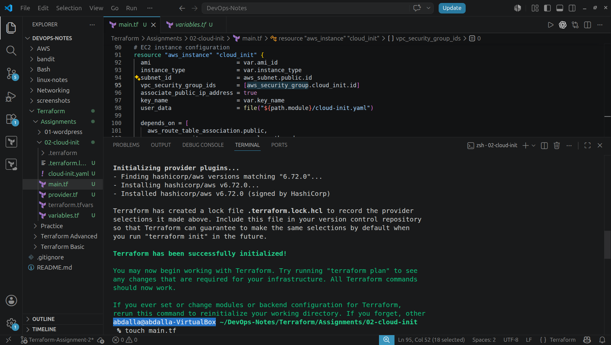

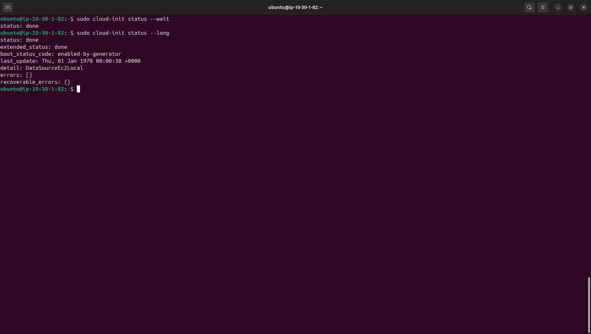

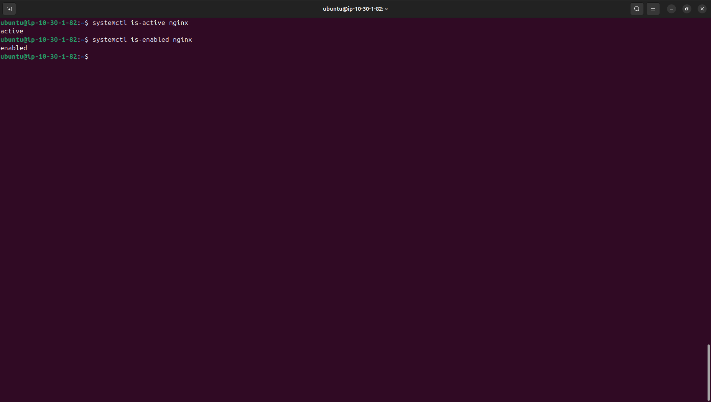

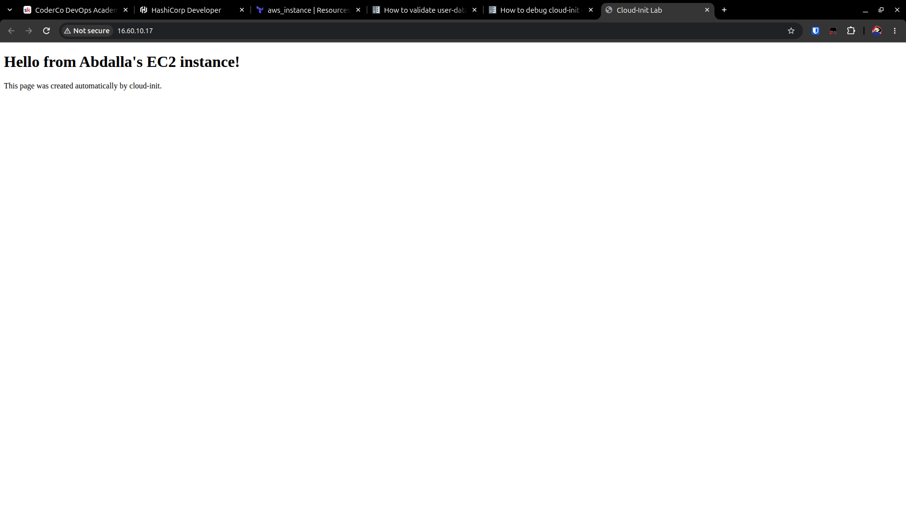

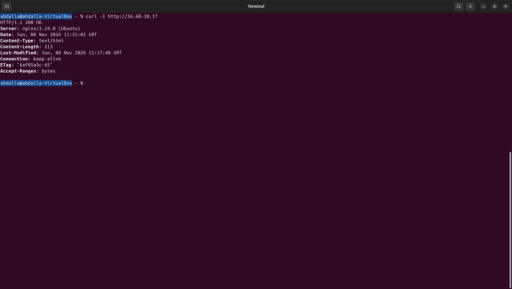

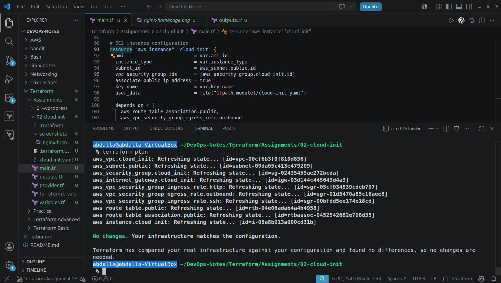

### DNS and HTTPS Extension

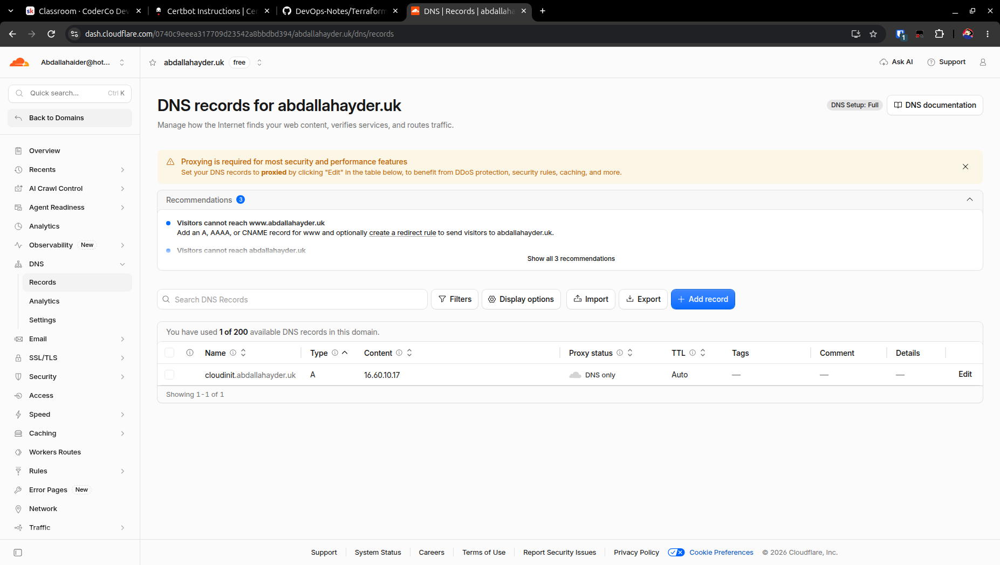

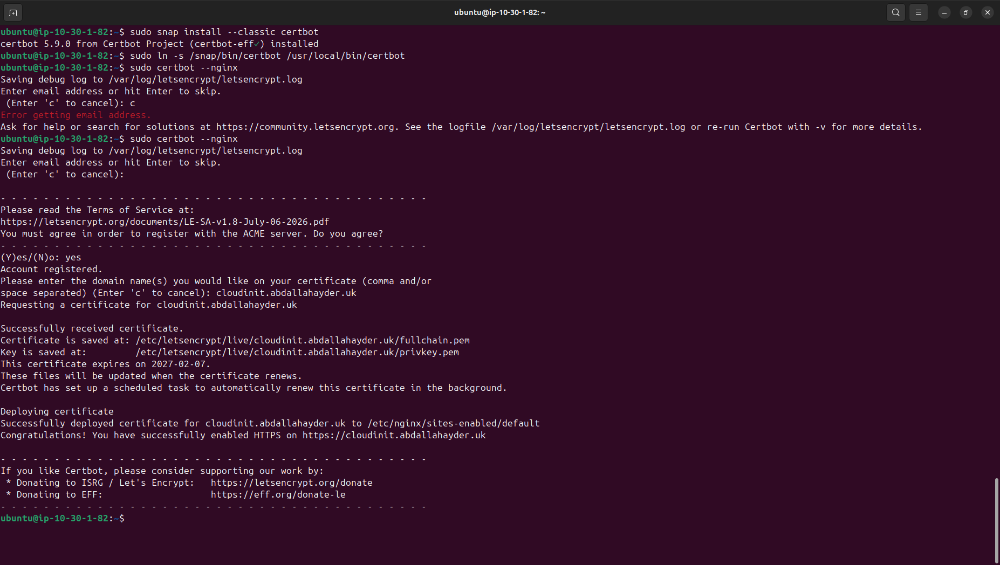

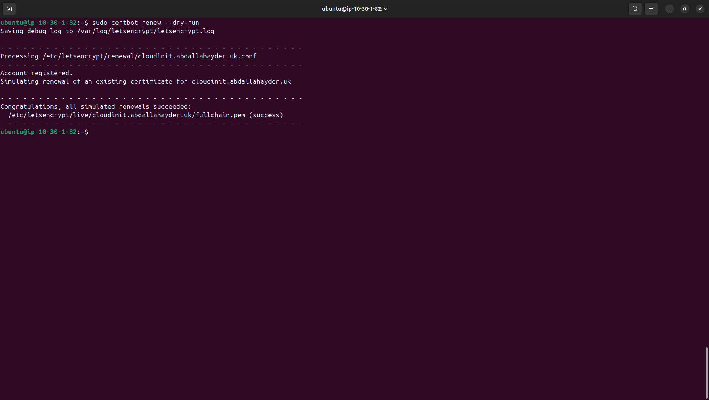

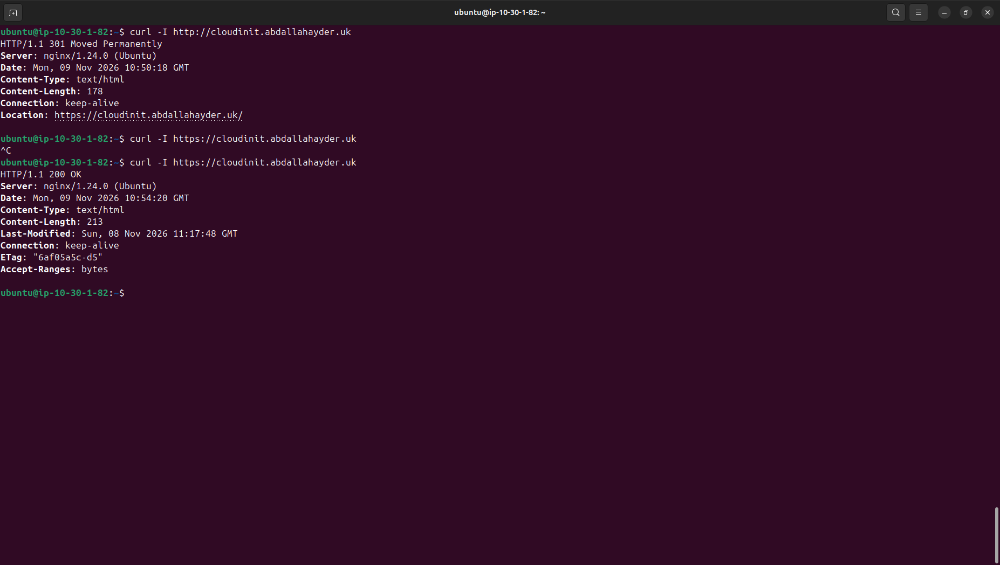

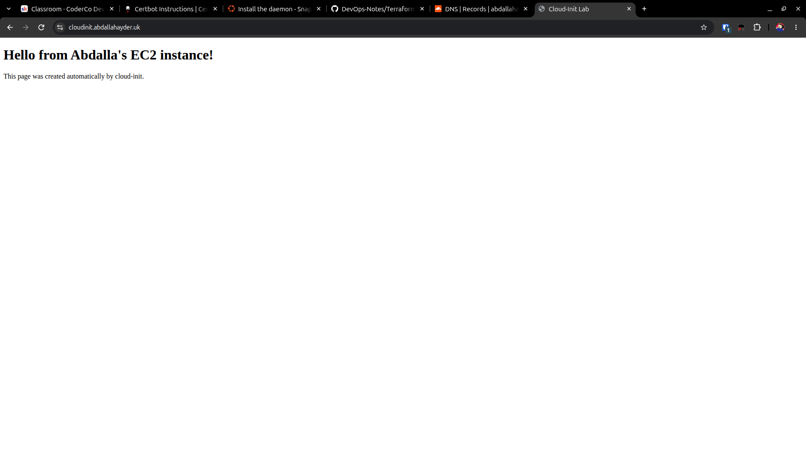

### Troubleshooting Evidence

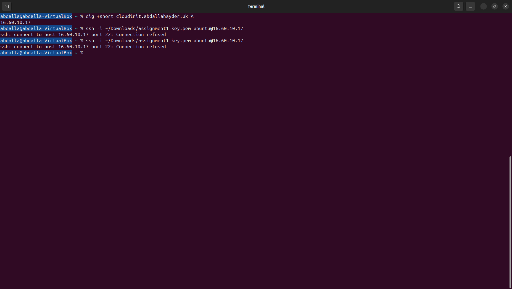

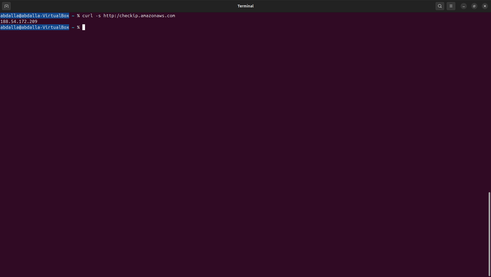

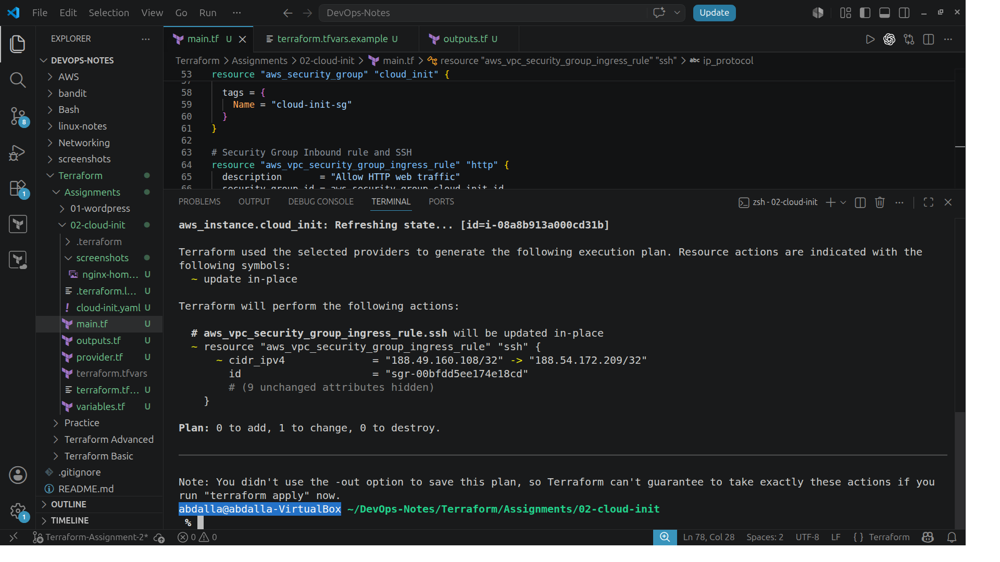

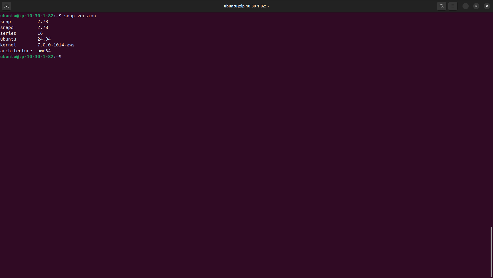

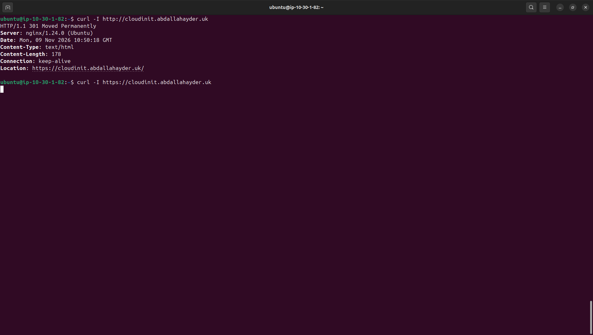

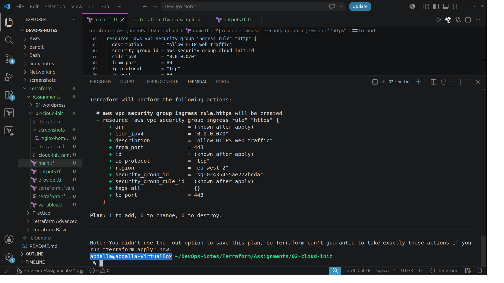

The rule-plan screenshots record proposed changes rather than completed
apply operations. Subsequent successful connections provide verification.

## Limitations

- One instance and availability zone provide no high availability.
- DNS and certificate setup are manual.
- Replacing EC2 requires repeating or restoring the HTTPS extension.
- An automatic public IPv4 can change after a stop/start.
- SSH access depends on a manually maintained source IP.
- Network settings remain hardcoded within the network module.
- The S3 backend bucket and EC2 key pair must already exist.
- Updating user data does not automatically rerun first-boot setup.
- Terraform's website output remains the HTTP/IP endpoint.
- No backup or monitoring configuration is included.

## Cleanup

From this assignment's root directory, preview deletion:

```bash
terraform plan -destroy
```

When ready:

```bash
terraform destroy
```

Review the actual plan before confirming. The current configuration
manages 11 resources.

Destroying the instance deletes its root volume with this deployment's
settings, including its homepage, NGINX configuration, and certificates.

The following are outside this Terraform configuration and remain:

- Existing S3 backend bucket and stored state objects.
- Existing EC2 key pair.
- Manually created Cloudflare DNS record.

After destruction, remove the DNS record pointing to the released
public IP unless it has been updated for another deployment.

These are cleanup instructions, not confirmation that cleanup has
already occurred. Running resources can continue to incur charges.

## References

- [Cloud-init validation](https://docs.cloud-init.io/en/latest/howto/debug_user_data.html)
- [Cloud-init module reference](https://docs.cloud-init.io/en/latest/reference/modules.html)
- [Terraform S3 backend](https://developer.hashicorp.com/terraform/language/backend/s3)
- [Terraform module refactoring](https://developer.hashicorp.com/terraform/language/modules/develop/refactoring)
- [AWS EC2 resource documentation](https://registry.terraform.io/providers/hashicorp/aws/6.72.0/docs/resources/instance)
- [Certbot with NGINX through Snap](https://certbot.eff.org/instructions?os=snap&ws=nginx)